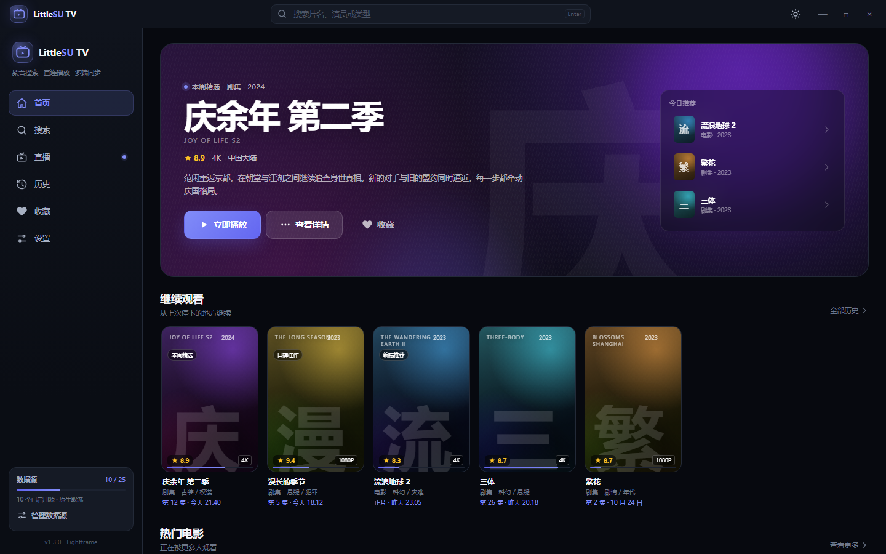

# Lightframe · LittleSU TV 新前端

LittleSU TV 独立客户端（Windows + Android）的新界面与新数据层：React + Vite + TypeScript。v1.3.0 起为客户端正式入口；旧版 `apps/app/public` 仍保留在仓库中用于回滚。

## 运行（浏览器预览）

```bash
cd apps/app/ui-next
npm install
npm run dev
```

打开 http://localhost:5174

- 默认显示**原型预览外框**：底部工具条可切换 **Windows / Android** 与 **深色 / 浅色**
- 在链接后加 `&standalone=1`（放在 `#` 之前）可隐藏预览外框，模拟客户端真实全屏布局：
  `http://localhost:5174/?standalone=1&device=windows&theme=dark#/`
- 浏览器内没有 Tauri 命令，搜索会自动回退到示例数据；直播仍可直接解析公开 M3U



## 在 Tauri 中运行

v1.3.0 起客户端入口已切换到本前端（`apps/app/src-tauri/tauri.conf.json` 的 `frontendDist` 指向 `ui-next/dist`），
`beforeDevCommand` / `beforeBuildCommand` 会自动处理前端构建。

```bash
# 开发：tauri dev 会自动启动 Vite（5174）并等待其就绪
cd apps/app
npm run dev

# 打包：自动执行 npm ci + 前端构建，然后构建安装包
cd apps/app
npm run tauri build
```

单独调试前端：`cd apps/app/ui-next && npm run dev`，浏览器打开 http://localhost:5174。

旧版 `apps/app/public` 仍保留在仓库中，如需回滚，把 `frontendDist` 改回 `../public` 即可。

## 预览链接

| 页面 | 链接 |
|---|---|
| Windows 首页（深色） | `http://localhost:5174/?device=windows&theme=dark#/` |
| Windows 首页（浅色） | `http://localhost:5174/?device=windows&theme=light#/` |
| Android 首页 | `http://localhost:5174/?device=android&theme=dark#/` |
| 搜索 | `#/search?q=庆余年` |
| 直播 | `#/live` |
| 播放页 | `#/player/qingyu-nian-2` |
| Android 详情页 | `?device=android#/title/qingyu-nian-2` |
| 源管理 | `#/settings?section=sources` |

## 已接入的真实能力

- 源选择、历史、收藏、主题、播放偏好全部落 `localStorage`，兼容旧版 `selectedAPIs` / `customAPIs` / `viewingHistory` 键
- 搜索：调用 Tauri 命令 `search_videos` 并行聚合已启用源，跨源去重、失败源提示；浏览器内自动回退示例数据
- 详情：按 `ids` 拉取 CMS 详情，解析剧集与简介；HTML 详情源做 m3u8 兜底
- 播放：hls.js + `fetch_text_native` / `fetch_bytes_native` 自定义 loader，绕过 WebView CORS；记忆进度与自动连播使用本地设置
- 直播：真实解析 5 个内置 M3U / TXT 源（分组、搜索、频道播放）
- 设置：导出 / 导入配置（含 SHA-256 校验），与旧版配置文件互通

## 目录

- `src/lib/env.ts` — Tauri 检测、原生命令调用、浏览器回退
- `src/lib/sources.ts` — 25 个内置源注册表与源选择持久化
- `src/lib/cms.ts` — 苹果 CMS 搜索 / 详情解析、跨源去重
- `src/lib/hooks.ts` — 搜索、详情、首页数据流、直播频道 hooks
- `src/lib/hlsNativeLoader.ts` — hls.js 原生取流 loader
- `src/lib/storage.ts` — localStorage 键、历史迁移、设置
- `src/store.tsx` — 设备 / 主题 / 收藏 / 历史 / 源选择 / Toast
- `src/layout.tsx`、`src/ui.tsx`、`src/detail.tsx`、`src/pages/` — 界面
- `docs/screenshots/` — 关键页面截图

## 待完成

1. 播放器音量、全屏、广告过滤等细节控件
2. 源测活与健康度展示、失败后切换到其他源重搜
3. Windows / Android 打包回归，并把 `frontendDist` 正式切换到新前端

截图仅用于设计确认；实际以运行中的界面为准。